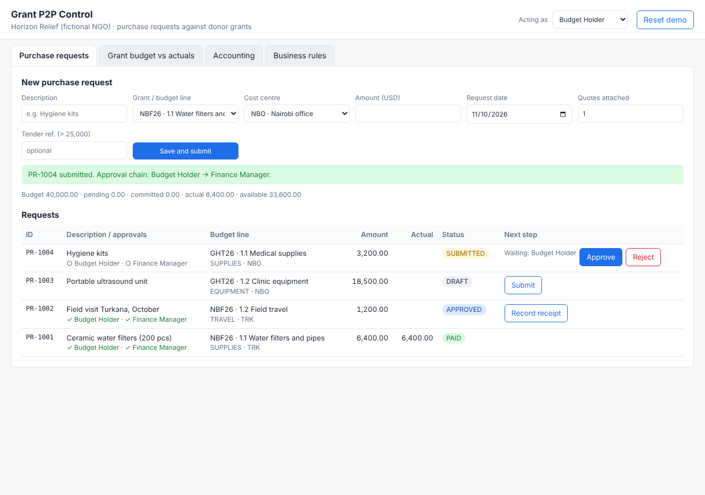
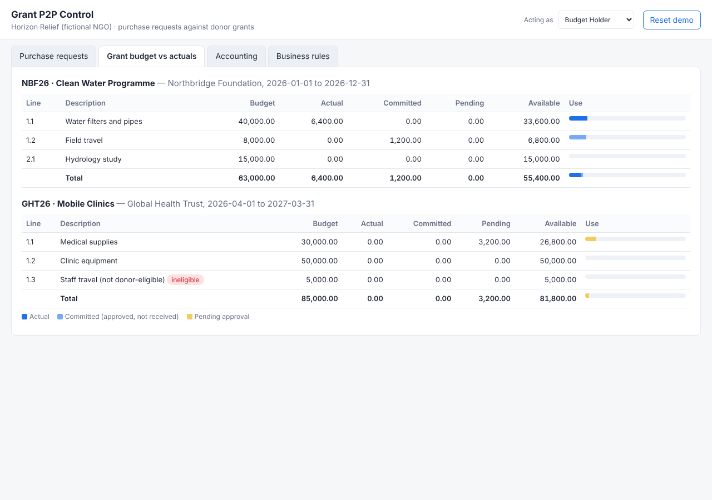
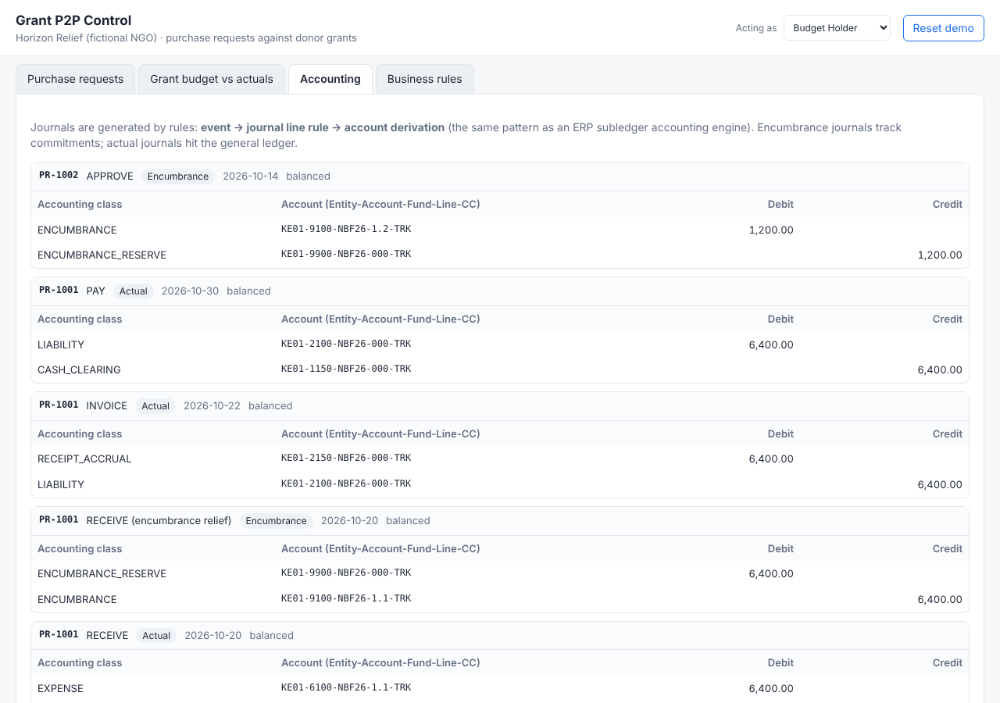

# Grant P2P Control

A working prototype of **grant-funded purchase-to-pay with budget control and automatic accounting** for a
multi-donor NGO. It takes the controls a large ERP gives you (eligibility, budgetary control, approval chains,
rule-based subledger accounting) and puts them into a small tool that runs in any browser.

Built by an ERP finance consultant using AI-assisted development (Claude): I wrote the requirements, business
rules and test cases from implementation practice; the code was built in pair with AI, then reviewed and tested.



## What it shows

| Donor / finance need | How the prototype handles it |
|---|---|
| Don't spend on costs the donor won't fund | Eligible cost categories per grant, checked on submit |
| Don't charge costs outside the grant period | Request date checked against grant start/end |
| Never overspend a budget line | Funds check: budget − pending − committed − actual |
| Follow procurement rules | 1 quote / 3 quotes / open tender by amount |
| Right people approve | Amount-based chain; Grant Manager joins when a line is > 90% used |
| See commitments, not only paid invoices | Encumbrance on approval, relieved on receipt |
| Ledger agrees with donor report | Accounts derived from grant, budget line and cost centre; fund = grant on every line |

## Try it

Open `app/index.html` in a browser. No install, no server, no build.
Use **Acting as** to switch approver role; **Reset demo** restores the sample data.

Run the rule tests (Node 18+):

```bash
npm test
```

Run the SQL model and reports (any SQLite client):

```bash
sqlite3 demo.db < sql/schema.sql && sqlite3 demo.db < sql/seed.sql && sqlite3 -header -column demo.db < sql/reports.sql
```

## Repository

```
docs/                    analysis and design
  01-business-context.md   problem, scope, roles
  02-user-stories.md       11 user stories with acceptance criteria
  03-process-flows.md      lifecycle, submission checks, approval chain (Mermaid)
  04-data-model.md         ER diagram and design notes
  05-accounting-rules.md   journal line rules, account derivation, worked example
  06-uat-test-cases.md     15 UAT scripts mapped to stories
  07-month-end-checklist.md close steps with SQL checks
  ai-workflow.md           how AI was used and what was checked by hand
app/
  engine.js                business rules (pure functions, unit-tested)
  seed.js                  demo data for a fictional NGO
  index.html               the prototype screen
tests/engine.test.js       12 automated tests
sql/                       schema, seed data, 7 report / control queries
```

## Screens

| Budget vs actuals | Accounting |
|---|---|
|  |  |

## Limitations

Single currency, full receipts only, browser-local storage, no login. See
[scope](docs/01-business-context.md#out-of-scope-next-iterations) for the next iterations.

All organisations, donors and figures are fictional.
