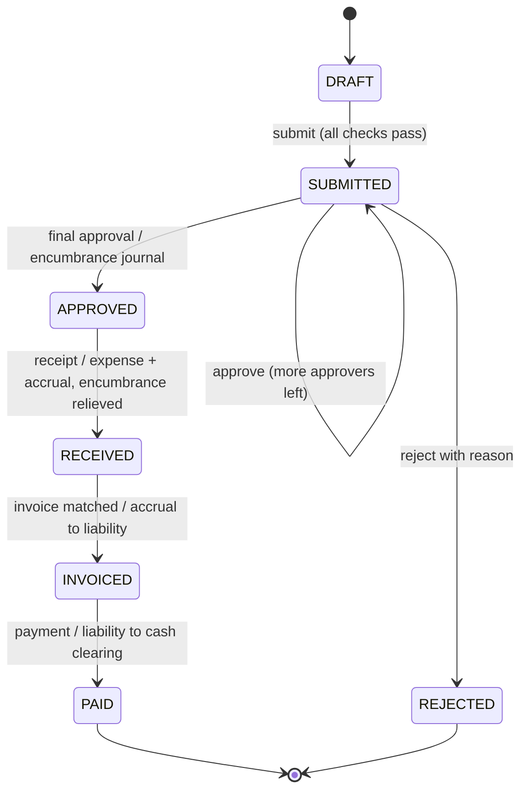
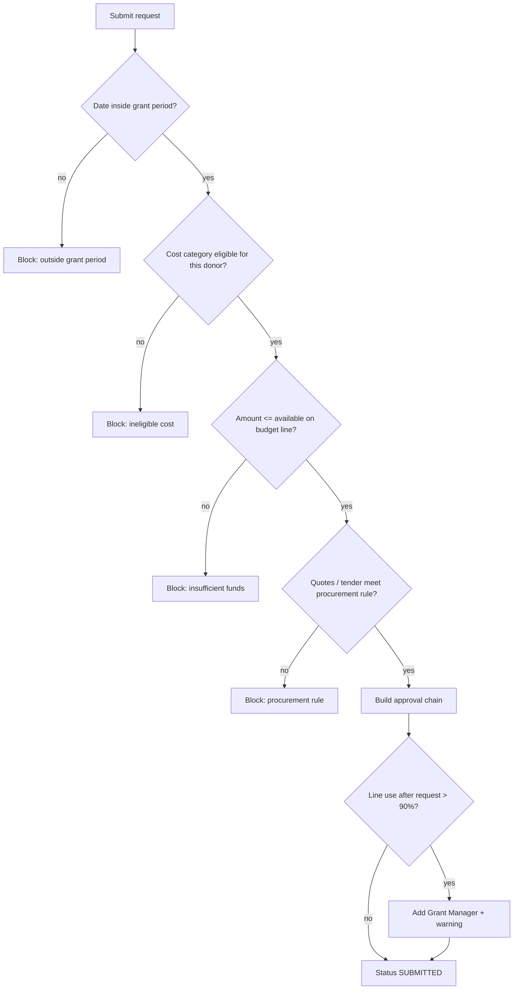

# 3. Process flows

## Purchase request lifecycle

## Submission checks

## Approval chain

| Amount | Approvers (in order) |
|---|---|
| < 1,000 | Budget Holder |
| 1,000 – 9,999 | Budget Holder → Finance Manager |
| ≥ 10,000 | Budget Holder → Finance Manager → Country Director |
| any, line > 90% used | Grant Manager inserted after Budget Holder |

## Money view along the process

| Step | Budget view | Ledger |
|---|---|---|
| Submitted | pending ↑ | — |
| Approved | pending ↓, committed ↑ | Encumbrance journal |
| Received | committed ↓, actual ↑ | Expense / accrual + encumbrance relief |
| Invoiced | — | Accrual → supplier liability |
| Paid | — | Liability → cash clearing (cleared later by bank reconciliation) |
