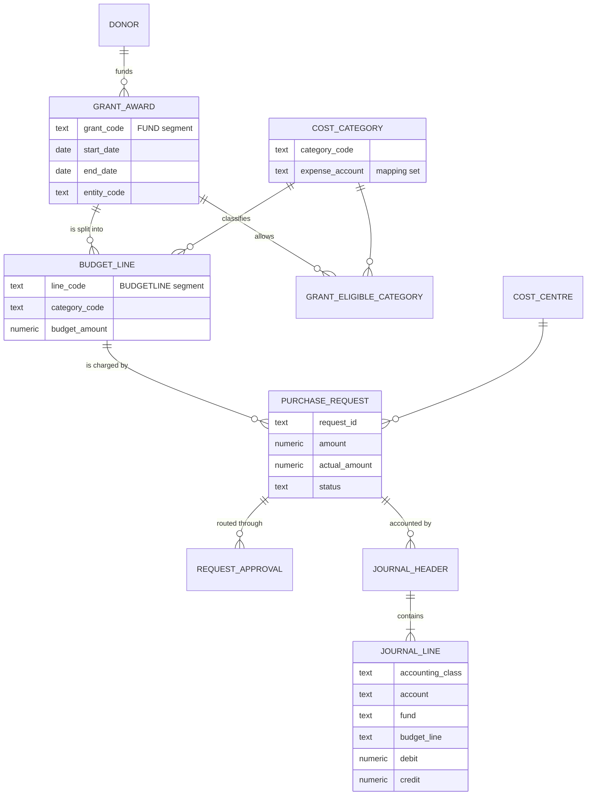

# 4. Data model

Full DDL: [`sql/schema.sql`](../sql/schema.sql). Demo data: [`sql/seed.sql`](../sql/seed.sql).

## Design notes

- **Grant code = fund segment.** Every journal line carries the grant, including balance-sheet lines. This is fund
  accounting: a balance sheet per grant can be produced, and grant reports come straight from the ledger.
- **Budget line as its own segment**, filled only on expense and encumbrance lines. Balance-sheet lines use `000`
  so accruals and liabilities are not split into meaningless pieces.
- **Eligibility is data, not code.** `grant_eligible_category` is maintained by the grant team per agreement;
  no developer is needed when a new grant is signed.
- **Status on the request plus journals as the audit trail.** Budget figures can be rebuilt either from request
  status (operational view) or from journals (accounting view); report 6 in `reports.sql` checks they agree.
